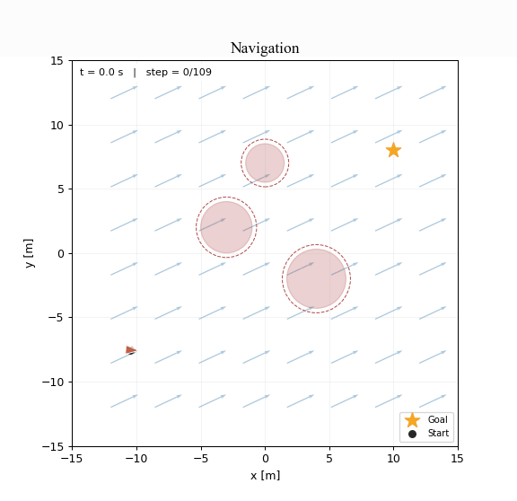

# AquaNav-RL

AquaNav-RL is a lightweight and reproducible benchmark for autonomous
underwater vehicle (AUV) navigation under spatially and temporally varying
ocean currents. The core simulator depends only on NumPy and Matplotlib. A
Gymnasium adapter and Stable-Baselines3 PPO training entry point are available
as optional dependencies.

The repository is intentionally small enough to read. It is designed for
students and researchers who want to test guidance, control, reinforcement
learning, robustness, and energy-aware planning without first installing a
large underwater simulator.

## Why this project

AUV navigation was the first research topic I explored after entering
university. At the time, I found very few reproducible open-source RL/DRL
projects for underwater navigation, and even fewer that supported
three-dimensional environments. Without a clear implementation to learn from
or build upon, I eventually had to pause the work.

This repository is the resource I wish I had then. It begins with a readable
planar 3-DOF baseline and is intended to grow toward spatial 5-DOF environments,
giving future students and researchers a clearer path to start, understand,
and extend AUV navigation research.



## What is included

- nonlinear planar 3-DOF AUV dynamics;
- uniform, vortex, oscillating, and zero-current fields;
- configurable circular obstacles, observation noise, and mission geometry;
- a plain Python environment and an optional Gymnasium adapter;
- independently trained PPO policies for no-current and uniform-current scenarios;
- an optional PPO training script;
- trajectory, current-field, energy, and path-length visualization;

This public version is a benchmark and educational implementation. It does not
contain adaptive control-frequency selection, safety projection, learned ocean
current estimation, or communication-aware multi-AUV coordination.

## Quick start

```bash
python -m venv .venv
source .venv/bin/activate
python -m pip install -e '.[rl]'
python main.py --current none
```

The command trains the no-current PPO policy and creates:

```text
result/seed_7/none/
├── best_model.zip
├── final_model.zip
├── evaluation_history.csv
├── training_config.json
└── actual_timesteps.txt
```

Train both policies, then generate plots and GIFs:

```bash
bash run_ppo.sh
```

Train PPO:

```bash
python -m pip install -e '.[rl]'
python -m aquanav.train_ppo --steps 1000000 --current none
python -m aquanav.train_ppo --steps 1000000 --current uniform
```

Evaluate and visualize both trained policies:

```bash
python -m aquanav.evaluate_ppo --model-dir result --seed 7 --episodes 100
```

## Repository layout

```text
AquaNav-RL/
├── aquanav/
│   ├── config.py          # physical and task parameters
│   ├── currents.py        # current-field models
│   ├── dynamics.py        # 3-DOF equations and RK4 integration
│   ├── environment.py     # simulator-independent task API
│   ├── gym_env.py         # optional Gymnasium adapter
│   ├── evaluation.py      # deterministic rollout and metrics
│   ├── visualization.py   # plots and GIF generation
│   ├── train_ppo.py       # Stable-Baselines3 PPO training
│   └── evaluate_ppo.py    # trained-policy evaluation and visualization
├── tests/
├── main.py                # PPO training entry point
├── run_ppo.sh             # two-scenario training and evaluation
├── visualization.py
└── pyproject.toml
```

## Vehicle model

The inertial pose and body-frame velocity are defined as

$$
\boldsymbol{\eta}=[x,y,\psi]^\top,\qquad \boldsymbol{\nu}=[u,v,r]^\top.
$$

where $x$ and $y$ represent the inertial position, $\psi$ is the heading angle,
and $u$, $v$, and $r$ denote the surge velocity, sway velocity, and yaw rate,
respectively. The superscript $\top$ denotes the transpose.

The kinematics are formulated as

$$
\dot{\boldsymbol{\eta}}=\mathbf J(\psi)\cdot\boldsymbol{\nu},
$$

where $\dot{\boldsymbol{\eta}}$ represents the time derivative of the inertial
pose, and $\mathbf J(\psi)$ is the transformation matrix from body-frame
velocity to inertial pose rate.

The dynamics are formulated as

$$
\mathbf M\cdot\dot{\boldsymbol{\nu}}+\mathbf C(\boldsymbol{\nu}_r)\cdot\boldsymbol{\nu}_r+\mathbf D(\boldsymbol{\nu}_r)\cdot\boldsymbol{\nu}_r=\boldsymbol{\tau}.
$$

where $\mathbf M$ is the mass and added-mass matrix, $\dot{\boldsymbol{\nu}}$
represents the body-frame acceleration, $\mathbf C$ is the Coriolis and
centripetal matrix, and $\mathbf D$ is the damping matrix. The vector
$\boldsymbol{\nu}_r$ represents the velocity relative to water, while
$\boldsymbol{\tau}$ denotes the applied forces and yaw moment.

The velocity relative to water is defined as

$$
\boldsymbol{\nu}_r=\boldsymbol{\nu}-\begin{bmatrix}\mathbf R^\top(\psi)\cdot\mathbf v_c^n\\0\end{bmatrix}.
$$

where $\mathbf v_c^n$ represents the inertial-frame current velocity, and
$\mathbf R(\psi)$ is the planar rotation matrix from the body frame to the
inertial frame. The zero entry represents the absence of a yaw-rate component
in the current velocity.

The action $\mathbf a\in[-1,1]^3$ is converted into surge force, sway force,
and yaw moment using the configured actuator limits. Nonlinear damping makes
the response speed-dependent. The state is integrated with fourth-order
Runge--Kutta at the default interval $\Delta t=0.1$ s.

## Current fields

The vortex field centered at $\mathbf c$ is defined as

$$
\mathbf v_c(\mathbf p)=V\cdot\frac{2 \rho R}{\rho^2+R^2}\cdot\frac{[-d_y,d_x]^\top}{\rho}.
$$

where $\mathbf p$ represents the position, $\mathbf c$ is the vortex center,
and $\mathbf v_c(\mathbf p)$ denotes the current velocity at that position.
The parameter $V$ is the nominal current strength, $R$ is the core radius,
and $\rho$ represents the distance from the vortex center. The terms $d_x$
and $d_y$ are the components of the displacement vector $\mathbf d$.

The displacement from the vortex center is defined as

$$
\mathbf d=\mathbf p-\mathbf c.
$$

where $\mathbf d$ represents the displacement vector from the vortex center
$\mathbf c$ to the position $\mathbf p$.

The distance from the vortex center is defined as

$$
\rho=\|\mathbf d\|.
$$

where $\rho$ represents the radial distance, and $\|\mathbf d\|$ is the
Euclidean norm of the displacement vector.

Its velocity approaches zero at the center, reaches its nominal strength near
the core radius $R$, and decays away from the core. The oscillating field adds
time-dependent direction and position-dependent phase, providing a simple
non-stationary disturbance for robustness experiments.

## Navigation task

At each time step $t$, the observation vector is defined as

$$
\mathbf o_t=\left[\frac{\Delta x}{W},\frac{\Delta y}{W},\cos\psi,\sin\psi,\frac{u}{u_{\max}},\frac{v}{v_{\max}},\frac{r}{r_{\max}},v_{c,x}^b,v_{c,y}^b,\frac{d}{2 W}\right].
$$

where $\Delta x$ and $\Delta y$ represent the relative position of the goal,
$W$ is the workspace scale, and $u_{\max}$, $v_{\max}$, and $r_{\max}$ are the
velocity normalization limits. The terms $v_{c,x}^b$ and $v_{c,y}^b$ denote
the body-frame current velocity components, while $d$ represents the distance
to the goal.

The heading angle is represented by $\cos\psi$ and $\sin\psi$ to maintain
continuity across the angular boundary. The body-frame current components
provide information about the disturbance relative to the vehicle orientation.

The reward function is formulated as

$$
r_t=w_p\cdot(d_{t-1}-d_t)-w_t-w_e\cdot\|\mathbf a_t\|^2+R_g\cdot\mathbb{I}_{\mathrm{goal}}-R_c\cdot\mathbb{I}_{\mathrm{failure}}.
$$

where $r_t$ represents the reward at time step $t$, $d_{t-1}$ and $d_t$ are
the distances to the goal at consecutive time steps, and $\mathbf a_t$ is
the normalized control action. The parameters $w_p$, $w_t$, and $w_e$ denote
the progress weight, per-step time penalty, and control-effort penalty weight,
respectively. The parameter $R_g$ is the goal reward, and $R_c$ is the failure
penalty. The indicator $\mathbb{I}_{\mathrm{goal}}$ equals one when the goal
is reached, while $\mathbb{I}_{\mathrm{failure}}$ equals one when a collision
occurs or the vehicle leaves the workspace. Each indicator is zero otherwise,
and $\|\cdot\|$ denotes the Euclidean norm.

Progress provides a dense learning signal, while the energy term discourages
unnecessary thrust. A rollout ends after reaching the goal, colliding, leaving
the workspace, or exhausting the step budget.

## Baselines and evaluation

The no-current and uniform-current scenarios use independently trained
Stable-Baselines3 PPO policies with `MlpPolicy`. During deterministic
evaluation, the normalized control action is formulated as

$$
\mathbf a_t=\operatorname{clip}\left(\boldsymbol{\mu}_{\theta}(\mathbf o_t),-1,1\right).
$$

where $\mathbf a_t$ represents the normalized surge, sway, and yaw control
action, $\mathbf o_t$ is the observation vector, and $\boldsymbol{\mu}_{\theta}$
denotes the mean action of the PPO policy with learned parameters $\theta$.
The function $\operatorname{clip}(\cdot,-1,1)$ limits each action component
to the interval $[-1,1]$.

Evaluation uses the saved `best_model.zip` checkpoint by default and applies
deterministic actions to held-out episode seeds. New algorithms should be
evaluated with repeated seeds and report:

- mission success and collision rate;
- final goal distance;
- path length and completion time;
- normalized control-energy proxy;
- mean and worst-case performance across current fields.

## Adding a controller

A controller used by the evaluation code needs a `predict` method:

```python
class MyController:
    def predict(self, observation, deterministic=True):
        ...
        return action, None  # NumPy array with shape (3,), values in [-1, 1]
```

It can then be passed as `model` to `aquanav.evaluation.run_episode(env, model, seed)`.


## License

MIT.
